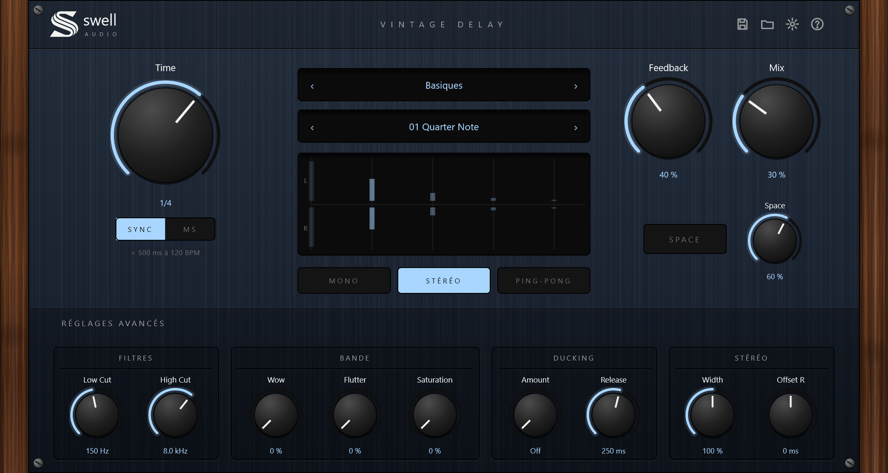
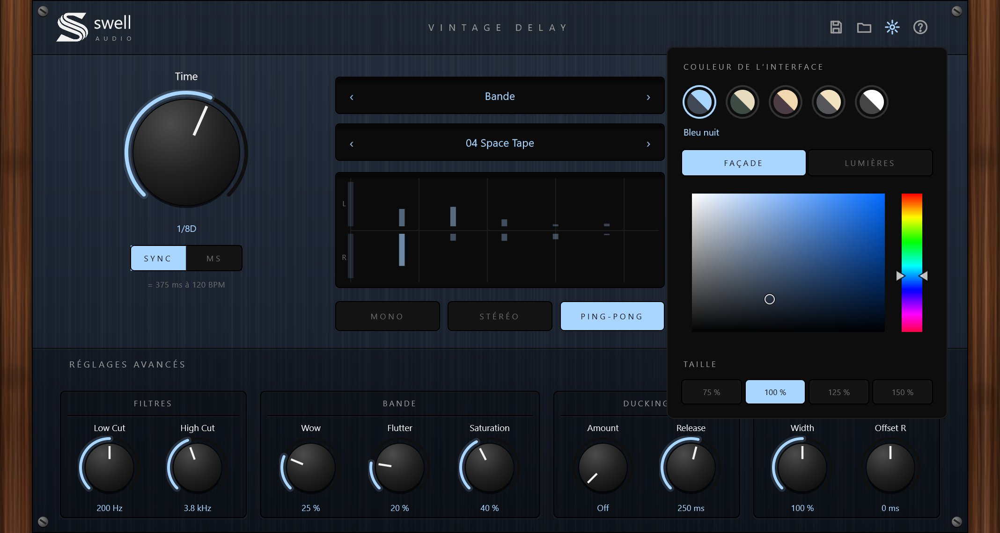

# Swell Delay — Vintage Delay 0.1.0

Un delay stéréo avec un côté bande, la façade en métal brossé et les joues en bois de la gamme Swell.
La couleur se change dans le plugin (bleu nuit par défaut).
Fabricant : Swell-audio. Formats : VST3 et Standalone (Windows), plus AU sur Mac.
Codes : PLUGIN_CODE `Sdly`, BUNDLE_ID `fr.swell-audio.delay` (à ne jamais changer une fois publié).



## Utilisation

1. Choisir une **catégorie** puis un **preset** (flèches ‹ ›, ou clic sur le nom pour la liste).
2. **Time** : en **SYNC**, le delay suit le tempo du morceau (de 1/64 à 1/1, en notes normales, pointées D et triolets T).
   En **MS**, le temps est libre (1 à 2000 ms). Sous le bouton, on voit la durée en ms au tempo actuel.
3. **Feedback** règle le nombre de répétitions. Au-dessus de 100 %, il passe en « Infini » : les répétitions tournent sans fin, sans exploser.
4. **Mix** règle la part de delay. Charger un preset ne change jamais le Mix.

| Commande | Rôle |
|---|---|
| MONO / STÉRÉO / PING-PONG | Répétitions au centre, gauche et droite séparées, ou qui rebondissent de gauche à droite. |
| SPACE + Space | Chaque répétition part à un endroit différent du champ stéréo, avec un léger flou d'espace. Le potard dose l'effet. |
| Filtres · Low Cut / High Cut | Coupent les graves et les aigus des répétitions (à chaque passage, comme une vraie bande). |
| Bande · Wow / Flutter / Saturation | Lente dérive de hauteur, scintillement rapide, et saturation chaude des répétitions. |
| Ducking · Amount / Release | Le delay se baisse quand la voix ou l'instrument joue, et remonte dans les blancs. |
| Stéréo · Width / Offset R | Largeur des répétitions (0 à 200 %), décalage du côté droit en mode Stéréo (±50 ms). |

L'écran central montre où tombent les répétitions (gauche en haut, droite en bas) sur deux secondes.
Elles s'allument quand elles passent, après chaque attaque du son.

## Couleur et taille

La roue crantée ouvre le panneau **Couleur de l'interface** :
- 5 teintes toutes faites : Bleu nuit, Vert anglais, Bordeaux, Acier & crème, Noir & blanc ;
- **Façade** et **Lumières** : un sélecteur pour choisir librement la couleur du métal et celle des lumières (arcs, écrans, boutons allumés) ;
- **Taille** : 75, 100, 125 ou 150 %.

Le choix est gardé pour toutes les instances du plugin (fichier `Swell Audio/Swell Delay.settings` dans les données de l'utilisateur).

## Presets

40 presets d'usine en 6 catégories : Basiques, Ping-Pong, Bande, Voix, Spatial, Créatifs.
Presets perso : la disquette enregistre un fichier `.swelldelay`, le dossier les recharge.
Ils sont rangés dans `Documents/Swell Audio/Swell Delay Presets`.

Raccourcis : double-clic sur un bouton = valeur par défaut, Shift + glisser = réglage fin.

## Écouter

Démos sur une voix (120 BPM) : voix sèche, puis la même phrase dans le delay.
[Quarter Note](Demo/01-Quarter-Note-AVANT-APRES.wav) · [Dotted Pong](Demo/02-Dotted-Pong-AVANT-APRES.wav) ·
[Dub Echo](Demo/04-Dub-Echo-AVANT-APRES.wav) · [Space Orbit](Demo/07-Space-Orbit-AVANT-APRES.wav)

## Moteur

Deux lignes à retard à interpolation Hermite (jusqu'à 4 s), changement de temps en glissé comme une bande.
Dans la boucle : passe-haut, passe-bas et saturation, puis un écrêtage doux qui empêche toute explosion même au-dessus de 100 %.
Wow et flutter modulent la tête de lecture. Sortie : largeur mid/side, SPACE (panoramique qui tourne au rythme du delay
et diffusion par 4 passe-tout), puis ducking piloté par l'entrée. Le tempo vient du logiciel hôte (120 BPM sinon).

## Compiler

Windows (Visual Studio 2022 Build Tools + CMake) :

```powershell
./build.ps1
```

Mac (VST3 + AU + Standalone, Intel et Apple Silicon) : `./build-mac.sh`.

À chaque envoi sur GitHub, l'onglet **Actions** compile Windows et macOS, lance les tests et fournit les fichiers prêts à installer.

Les tests (`Tests/AudioTest.cpp`) vérifient : les 40 presets (bornés, répétitions qui s'éteignent),
la précision du temps en ms et en SYNC, le rapport de feedback, le ping-pong gauche / droite,
l'offset stéréo, la transparence à Mix 0 et en bypass, le feedback infini borné, le ducking,
l'effet SPACE, 30 réglages au hasard, la sauvegarde de session et les presets perso.

Capture de l'interface : `build/DelaySnapshot_artefacts/Release/DelaySnapshot.exe docs/swell-delay.png [preset] [teinte 0-4] [colours]`.
Démos audio : `DelayDemo Demo/source-voix.wav Demo/renders` (voir `Demo/SOURCE-ET-METHODE.txt`).


